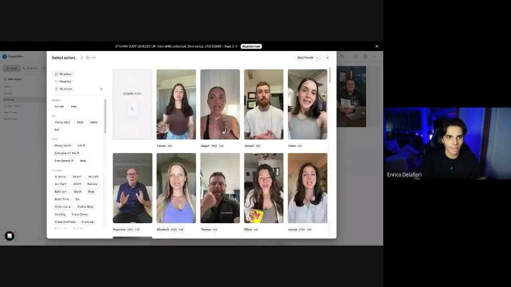
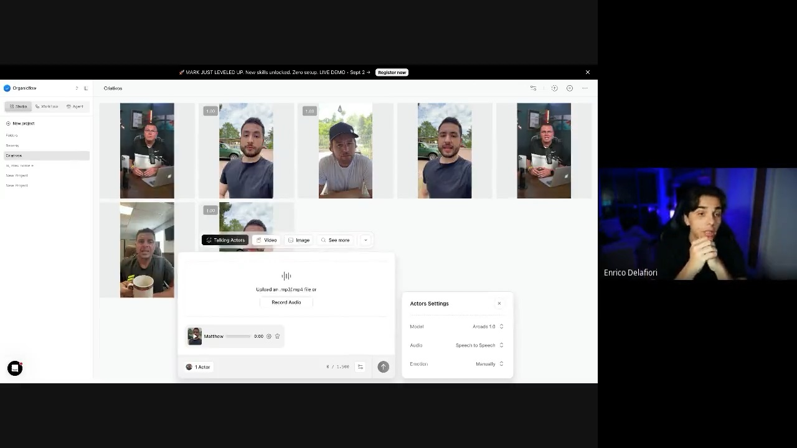
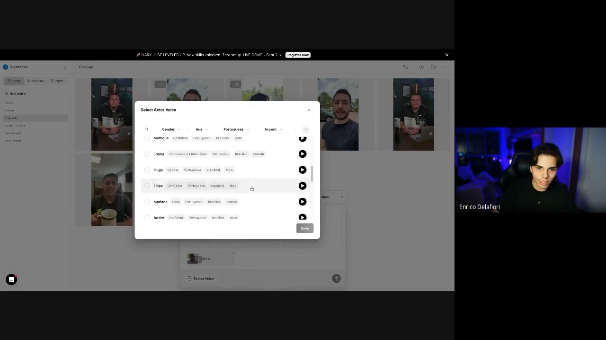
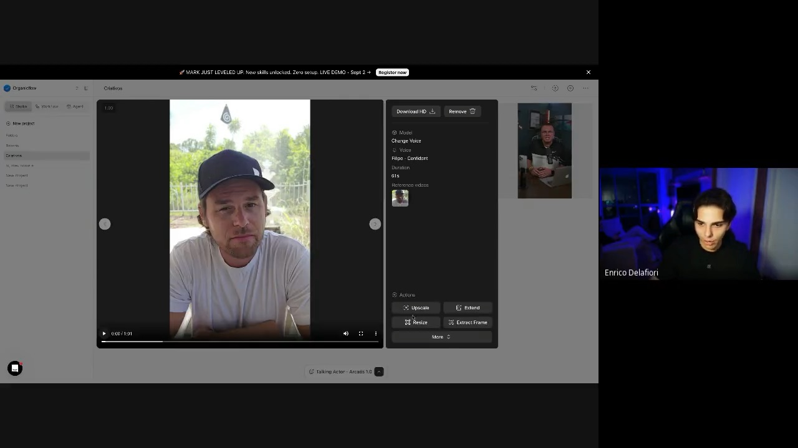

# Arcads: como o Enrico faz os criativos

Parte técnica, passo a passo. Transcrito do tutorial ao vivo na Aula 02, entre
**66:40 e 69:30** da gravação, com os frames da tela dele em
`arcads-passo-a-passo/`.

A conta que aparece na tela é a dele, workspace **OrganicFlow**, projeto
**Criativos**.

---

## O resumo em dez linhas

1. Abrir o projeto e ir na aba **Talking Actors**
2. **Add Actors** e escolher **Magnus** ou **Matthew** (os dois que ele validou)
3. Em **Actors Settings**, trocar `Text to Speech` para **`Speech to Speech`**
4. Gravar a copy na **sua própria voz**, com as entonações certas
5. Subir o `.mp3` ou `.mp4` no campo de áudio
6. Se a voz do ator ficar com sotaque americano: **More > Change Voice**
7. Em **Select Actor Voice**, filtrar idioma **Portuguese** e escolher a voz
8. Ele usa a **`Filipe · Confident`**
9. **Gerar**
10. **Download HD**

---

## Passo 1 · Escolher o ator

Aba **Talking Actors**, botão **Add Actors**. Abre o modal `Select actors`.

**O que tem nesse modal:**

| Área | Opções |
|---|---|
| **Topo** | Busca, e ordenação por `Most Popular` |
| **Listas** | `All actors` · `Favorites` · `My actors` |
| **Gender** | `Female` · `Male` |
| **Age** | `Young Adult` · `Adult` · `Senior` · `Kid` |
| **Type** | `Newly Added` · `HD` · `Exclusive For Pro` · `Free Speech` · `Real` |
| **Situation** | `AI Avatar`, `Airport`, `Arc Left`, `Arc Right`, `ASMR`, `Balcony`, `Bathroom`, `Beach`, `Boat`, `Bullet Time`, `Car`, `Christmas`, `Coffee Shop`, `Cooking`, `Crane Down`, `Crane Overhead`, `Crane Up`, e continua |

Cada ator vem com selo `HD` ou `PRO HD`. Tem também um tile **`Create actor`**,
para criar ator próprio.

**Ele não cria ator nenhum.** Nas palavras dele:

> *"Isso aqui são os atores. Eu não precisei criar nenhum. Os que eu validei
> foram esses dois aqui."*

**Os dois atores que ele usa: `Magnus` e `Matthew`.**

Busca por nome em cima, em `All actors`, seleciona e clica **Add**.

---

## Passo 2 · Trocar para Speech to Speech

Com o ator adicionado, abre o painel **`Actors Settings`**, no canto direito.

**Três campos, e um deles decide o criativo:**

| Campo | Valor na tela dele |
|---|---|
| **Model** | `Arcads 1.0` |
| **Audio** | **`Speech to Speech`** |
| **Emotion** | `Manually` |

**A troca obrigatória é `Text to Speech` → `Speech to Speech`.** O motivo, na
voz dele:

> *"Os criativos você não vai fazer com texto, porque se fizer texto fica uma
> entonação zoada."*

Na mesma tela aparece o painel de áudio: **`Upload an .mp3/.mp4 file`** ou
**`Record Audio`**, com o ator listado abaixo (`Matthew`, `0:00`), o contador
**`0 / 1,500`** caracteres, o marcador **`1 Actor`** e o botão de gerar à
direita.

As abas embaixo: **`Talking Actors`** · `Video` · `Image` · `See more`.

---

## Passo 3 · Gravar a copy na sua voz

> *"Tu vai abrir teu gravador de voz e vai ler a copy com as entonações
> corretas, igual o meu."*

O exemplo de leitura que ele deu ao vivo, para mostrar a entonação:

> *"Cara, esse subcontractor deu $20.000 por mês"*, ou *"cara, eu faturava ali
> $30.000, $40.000 por mês, e sim, nos últimos 30 dias eu faturei $80.000."*

Depois é só subir o arquivo no campo de áudio e clicar em gerar.

**A voz que sai não é a sua.** Perguntaram isso na call:

> **Aluno:** *"Mas aí vai ficar com a sua voz?"*
> **Enrico:** *"Não, ele muda para voz do personagem."*

O que o Speech to Speech aproveita da sua gravação é o **ritmo, a pausa e a
entonação**, não o timbre.

---

## Passo 4 · Trocar a voz, quando sair com sotaque

Problema que ele mesmo levanta:

> *"Na do Magnus originalmente ele vai vir com a voz dele mesmo dublada para
> português, só que fica meio ruim porque ele tem alguns acentos americanos."*

**Caminho:** `More` → `Change Voice` → abre o modal **`Select Actor Voice`**.

**Filtros no topo:** busca, `Gender`, `Age`, **`Portuguese`**, `Accent`.

Com `Portuguese` ligado, a lista que aparece na tela dele é toda de voz
brasileira, cada uma com um selo de característica e um play para ouvir:

| Voz | Característica | Variante | Gênero |
|---|---|---|---|
| `Matheus` | Confident | brazilian | Male |
| `Joana` | Informative & Educational | brazilian | Female |
| `Hugo` | Upbeat | standard | Male |
| **`Filipe`** | **Confident** | standard | Male |
| `Mariana` | Calm | brazilian | Female |
| `Andre` | Confident | brazilian | Male |

**A que ele usa é a `Filipe · Confident`.** Ouve, seleciona, **`Save`**.

> *"Vai ver qual que você acha que conecta mais dentre todas essas aqui, que
> isso aqui é só de brasileiro. Aqui a gente utilizou foi esse Filipe,
> Confiança."*

---

## Passo 5 · Gerar e baixar

O vídeo pronto aparece no player, e o painel da direita mostra a ficha dele:

| Campo | Valor |
|---|---|
| **Model** | `Change Voice` |
| **Voice** | `Filipe - Confident` |
| **Duration** | `61s` |
| **Reference videos** | miniatura do áudio de referência que você subiu |

**Botões:** **`Download HD`** e `Remove`.

**Em `Actions`:** `Upscale` · `Extend` · `Resize` · `Extract Frame` · `More`.

No rodapé fica o carimbo do que gerou aquilo: **`Talking Actor · Arcads 1.0`**.

> *"Aí é só gerar e pronto, mano. Baixar aqui, já vai estar pronto."*

---

## Preço, na boca dele

Perguntaram na call e ele respondeu com o valor que tinha acabado de pagar:

| | |
|---|---|
| **Primeiro mês** | **R$ 396** (ele assinou no dia da aula) |
| **Depois** | **R$ 560 por mês** |
| **O que rende** | **10 vídeos por mês** |

> *"R$400 por mês, 10 vídeos. R$396, eu assinei hoje inclusive. Isso só no
> primeiro mês. Depois vai para R$560 por mês."*

**Atenção, isto corrige um número do projeto.** A anotação em `estrategia.md` e
no pacote de criativos diz **US$ 110 por 10 vídeos**. A aula diz **R$ 396 no
primeiro mês e R$ 560 depois**. Os dois podem estar certos em momentos ou
planos diferentes, mas confira no site antes de assinar.

**E ele não usa os 10:**

> **Aluno:** *"Vai precisar usar todos os templates, os 10 vídeos?"*
> **Enrico:** *"Não, mano. Se você fizer certinho como eu ensinei aqui, tu faz
> os 3, 5 e já era."*

---

## Os parâmetros técnicos, numa tabela só

| O que | Valor |
|---|---|
| **Model** | `Arcads 1.0` |
| **Audio** | `Speech to Speech` (nunca Text to Speech) |
| **Emotion** | `Manually` |
| **Atores** | `Magnus` e `Matthew` |
| **Voz** | `Filipe · Confident`, filtro `Portuguese` |
| **Teto do campo de script** | `1,500` caracteres |
| **Duração gerada no exemplo** | `61s` |
| **Saída** | `Download HD` |

---

## O que ele pede fora da ferramenta

Isto não é Arcads, é produção, mas ele amarrou os dois no mesmo bloco da aula:

- **Áudio perfeito.** Microfone de R$ 200 a 300. O motivo técnico que ele dá: o
  Meta otimiza pela transcrição do áudio e das imagens, e ruído joga o anúncio
  para um público errado
- **Roupa all black.** Calça e camiseta pretas, nada social
- **ICP nos 3 a 5 primeiros segundos**, sem exceção: a palavra `subcontractor`,
  ou `empresário da construção`, ou `home services`. O Meta qualifica o lead
  pelos primeiros segundos
- **Headline estática** nos 5 primeiros segundos, parada, para dar tempo de ler
- **Legenda pequena**, fundo na cor da logo, sem cor chamativa
- **Não cortar os respiros** entre as falas. O público é mais velho e prefere
  natural
- **Editor dele:** Rian, cerca de **R$ 50 por criativo**, com desconto em lote
  de 3 a 5

---

## De onde saiu cada coisa

| Fonte | O quê |
|---|---|
| `_memoria/historico/FONTES/aulas-novas-videos/Aula 02 ... .mp4` | Os quatro frames, extraídos entre 66:40 e 68:00 |
| `_memoria/historico/FONTES/aulas-novas-transcricoes/aula-02-transcricao.txt` | Todas as falas citadas |

Os frames trazem a interface da chamada por cima: a miniatura dele no canto
direito e a barra do topo. O que interessa é a tela compartilhada, à esquerda.
