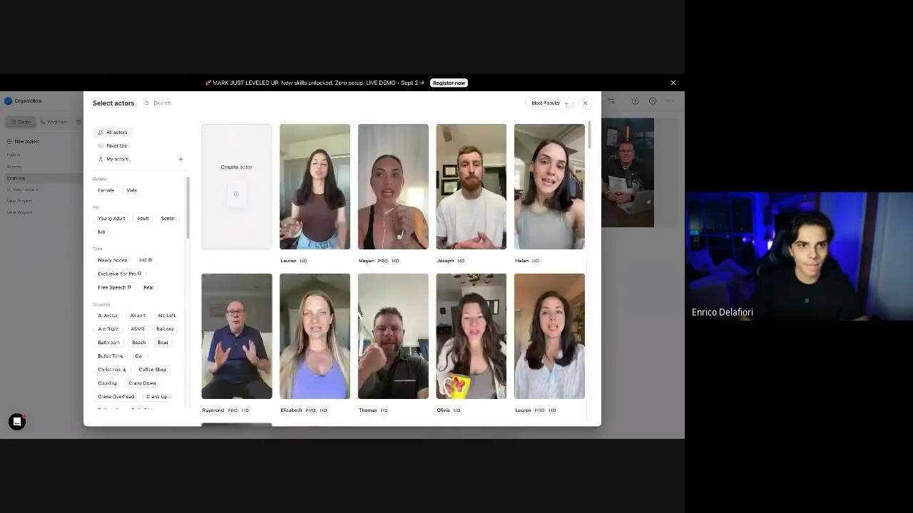
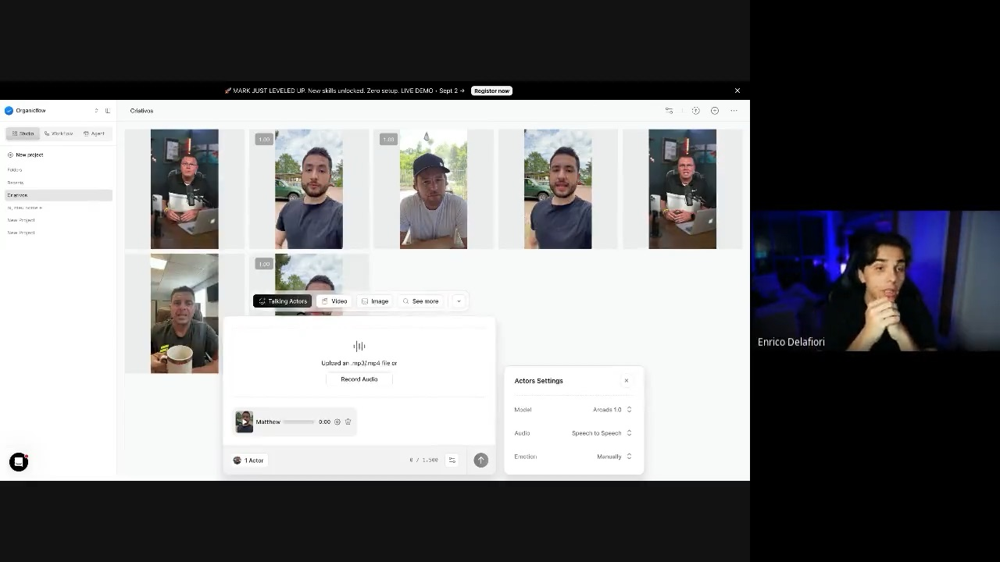
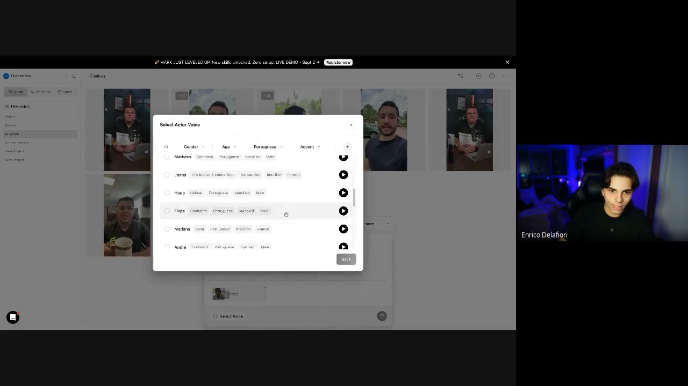
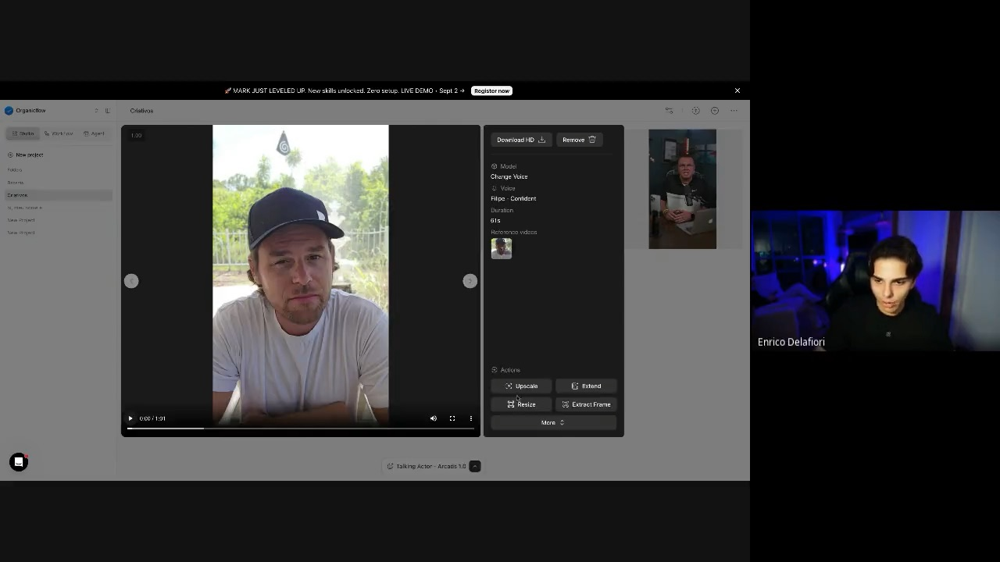

# Arcads · manual técnico da ferramenta

Documento para ser entregue a uma inteligência artificial que vai **auxiliar na
produção de criativos em vídeo no Arcads**.

Só a parte técnica: interface, parâmetros, modelos, limites, planos e as
armadilhas. Sem estratégia de copy e sem roteiro, que entram depois.

**Duas origens, e elas não têm a mesma idade:**

| Origem | O que vem dela | Quando |
|---|---|---|
| Gravação de uma aula com a conta na tela | Os nomes dos campos, o passo a passo e os valores da interface | Versão antiga do produto |
| Print da tela de planos | Preços, créditos, limites e recursos por plano | Atual |

**Onde as duas divergem, o print manda.** Os pontos de divergência estão
marcados um a um.

---

## ⚠ Informação faltante, a ser preenchida depois

**Os roteiros ainda não existem neste documento.** Eles serão escritos do zero e
entregues em outro momento.

Portanto, **não assuma nada sobre**: quantidade de criativos, duração de cada
um, contagem de caracteres, quantos serão gerados por IA e quantos serão
gravados por pessoa, quais atores, qual voz, qual cenário, qual idioma.

**Quando os roteiros chegarem, a primeira tarefa é a verificação de caracteres
descrita na seção "Verificação obrigatória de caracteres", mais abaixo.** Até
lá, este documento é só o manual da ferramenta.

---

## 1. Os planos, e como eles realmente limitam a produção

Valores da tela de planos, cobrança **mensal**. Há um desconto de **30%** ativo
e um botão `YEARLY` com **20% OFF** por tempo limitado, que não está detalhado
aqui porque a tela lida estava em `MONTHLY`.

| | **Starter** | **Creator** (`MOST POPULAR`) | **Pro** |
|---|---|---|---|
| **Preço/mês** | **US$ 77** (de US$ 110) | **US$ 154** (de US$ 220) | **US$ 385** (de US$ 550) |
| **Créditos/mês** | 8.000 | 16.000 | 48.000 |
| **Segundos de AI Avatar falando** | **até 600** | até 1.200 | até 3.600 |
| **AI video clips** | até 50 | até 100 | até 300 |
| **AI Avatar Reactions** | não | até 100 | até 100 |
| **Natural AI Actors** | 300 | 1.000 | 1.500 |
| **Access to All Models** | sim | sim | sim |
| **Mark** (agente que monta anúncios ponta a ponta) | sim | sim | sim |
| **MCP** (conectar a Claude, Cursor e outros) | sim | sim | sim |
| **Workflows** (pipeline de vídeo automatizado) | **não** | sim | sim |
| **Remove background & AI captions** | **não** | sim | sim |
| **API access** | não | não | sim |
| **Team collaboration / seats** | não | não | assentos ilimitados grátis |
| **ElevenLabs** | não | não | integração |
| **Custom Actors** (clonar ator próprio) | não | não | sim |
| **Créditos não usados acumulam** | **não** | **não** | sim |
| **Slack e call direta com o time** | não | não | sim |
| **Imagens NanoBanana grátis/mês** | 200 | 1.000 | 3.000 |
| **Nota extra** | | | `Save 17% per video` |

Os três planos exibem o selo **`SEEDANCE 2.5 LATEST`**.

### O limite que morde primeiro

**Não é o preço, são os segundos.** O `Starter` dá **600 segundos de AI Avatar
falando por mês**. Traduzindo para produção:

| Duração do criativo | Quantos cabem em 600s |
|---|---|
| 30 segundos | 20 |
| 45 segundos | **13** |
| 60 segundos | 10 |

**E cada regeração consome de novo.** Um vídeo de 45 segundos que você gerou
três vezes até ficar bom custou 135 dos seus 600 segundos, não 45. Com dez
regerações espalhadas pelo mês, um terço do plano `Starter` foi embora sem
nenhum vídeo a mais no disco.

**O segundo limite é o número de clipes:** 50 no `Starter`. Também conta
tentativa, não só acerto.

**No `Starter` e no `Creator`, crédito não usado NÃO acumula.** Só o `Pro`
acumula. Então sobra de mês não vira reserva: evapora na virada.

### O que isto significa na prática

- **Teste caro é o que mata o plano**, não o volume final. Calibre os
  parâmetros em um vídeo e só depois rode o lote
- **Se a produção for concentrada**, assinar um mês do plano maior e cancelar
  pode custar menos que estourar o menor e ter que subir no meio
- **`Workflows` e `Remove background & add AI captions` só existem do `Creator`
  para cima.** Se legenda automática fizer parte do processo, o `Starter` está
  fora
- **Clonar ator próprio só no `Pro`**, via `Custom Actors`

---

## 2. A estrutura da conta

| Nível | O que é |
|---|---|
| **Workspace** | O espaço da conta, com nome próprio |
| **Projeto** | Pasta de trabalho. Existe `New project` na lateral |
| **Navegação lateral** | `Folders`, `Recents`, `Creations` |
| **Abas do topo** | `Studio` · `Workflow` · `Agent` |

As três abas do topo correspondem aos três modos do produto: **`Studio`** é a
geração manual descrita neste documento, **`Workflow`** é o pipeline
automatizado (do `Creator` para cima) e **`Agent`** é o `Mark`, que monta
anúncios ponta a ponta.

Dentro do `Studio`, a barra de ferramentas tem: **`Talking Actors`** · `Video` ·
`Image` · `See more`.

---

## 3. Passo a passo, do zero ao arquivo baixado

### Passo 1 · Escolher o ator

**Caminho:** aba `Talking Actors` → botão **`Add Actors`** → abre o modal
**`Select actors`**.

**Filtros do modal, com os rótulos exatos:**

| Grupo | Opções |
|---|---|
| Listas | `All actors` · `Favorites` · `My actors` |
| `Gender` | `Female` · `Male` |
| `Age` | `Young Adult` · `Adult` · `Senior` · `Kid` |
| `Type` | `Newly Added` · `HD` · `Exclusive For Pro` · `Free Speech` · `Real` |
| `Situation` | `AI Avatar`, `Airport`, `Arc Left`, `Arc Right`, `ASMR`, `Balcony`, `Bathroom`, `Beach`, `Boat`, `Bullet Time`, `Car`, `Christmas`, `Coffee Shop`, `Cooking`, `Crane Down`, `Crane Overhead`, `Crane Up`, e continua |
| Ordenação | `Most Popular` |
| Busca | Campo de texto no topo, busca por nome |

Cada ator traz selo **`HD`** ou **`PRO HD`**. O primeiro tile da grade é
**`Create actor`**.

**Como usar:** filtrar, ou buscar por nome com `All actors` ativo, selecionar,
**`Add`**.

**Ponto de atenção sobre `Situation`.** O filtro descreve **onde o ator está e
como a câmera se move**, não o que ele fala. `Car`, `Coffee Shop`, `Balcony` e
`Bathroom` são cenários; `Arc Left`, `Arc Right`, `Crane Up`, `Crane Down`,
`Crane Overhead` e `Bullet Time` são movimentos de câmera. Escolher um
movimento de câmera quando você queria um cenário é um erro fácil de cometer e
só aparece depois de gerar.

**A biblioteca varia por plano:** 300 atores no `Starter`, 1.000 no `Creator`,
1.500 no `Pro`. Um ator visto num plano pode não existir noutro.

---

### Passo 2 · Os parâmetros em Actors Settings

Painel **`Actors Settings`**, no lado direito.

**Três campos:**

| Campo | Valores observados | Observação |
|---|---|---|
| **`Model`** | `Arcads 1.0` | Ver a seção de modelos |
| **`Audio`** | `Text to Speech` ou **`Speech to Speech`** | **É o parâmetro que mais muda o resultado** |
| **`Emotion`** | `Manually` | |

### `Speech to Speech` versus `Text to Speech`

**`Text to Speech`:** você digita o texto e a ferramenta sintetiza a fala. É o
padrão, e é o que produz entonação robótica.

**`Speech to Speech`:** você sobe uma gravação de voz humana e a ferramenta
**troca o timbre pelo do personagem, preservando ritmo, pausa e entonação da
gravação original**.

A recomendação de quem demonstrou a ferramenta é categórica: **usar sempre
`Speech to Speech`**, porque com texto *"fica uma entonação zoada"*.

**A voz que sai não é a de quem gravou.** Perguntado diretamente se o vídeo
sairia com a voz do locutor, ele respondeu: *"Não, ele muda para voz do
personagem."* O que sobrevive da gravação é a **performance**, não o timbre.

**Consequência operacional:** com `Speech to Speech`, a qualidade do criativo
passa a depender de uma gravação humana bem feita. Não existe atalho: áudio
ruim entra, vídeo ruim sai.

---

### Passo 3 · O áudio

**Campo central**, com duas entradas:

- **`Upload an .mp3/.mp4 file`**
- **`Record Audio`**, gravação direto na página

Abaixo aparece a linha do ator selecionado com o tempo do áudio carregado (nome
do ator e `0:00` antes de subir o arquivo), o marcador **`1 Actor`**, o contador
de caracteres e o botão de gerar, à direita.

**Requisito técnico do áudio, e o motivo:** o áudio precisa estar limpo, sem
ruído de fundo. A justificativa dada é que **o Meta otimiza a entrega pela
transcrição do áudio e das imagens**, então ruído degrada a qualificação do
público que recebe o anúncio. Um microfone de entrada resolve; áudio de câmera
de celular em ambiente aberto, não.

---

### Passo 4 · Gerar

Com ator adicionado, parâmetros marcados e áudio subido, o botão de gerar fica
ativo no canto do painel de áudio.

**Cada geração consome segundos e um clipe da cota, dê certo ou não.**

---

### Passo 5 · Trocar a voz, quando o sotaque atrapalha

**O problema relatado:** atores da biblioteca dublados para outro idioma saem
*"com alguns acentos americanos"*, o que quebra a naturalidade.

**Caminho:** **`More`** → **`Change Voice`** → abre o modal **`Select Actor
Voice`**.

**Filtros do modal:** busca, `Gender`, `Age`, **idioma** (no exemplo,
`Portuguese`), `Accent`.

**Vozes em português observadas na biblioteca:**

| Voz | Característica | Variante | Gênero |
|---|---|---|---|
| `Matheus` | Confident | brazilian | Male |
| `Joana` | Informative & Educational | brazilian | Female |
| `Hugo` | Upbeat | standard | Male |
| `Filipe` | Confident | standard | Male |
| `Mariana` | Calm | brazilian | Female |
| `Andre` | Confident | brazilian | Male |

Repare na coluna **variante**: `brazilian` e `standard` são coisas diferentes.
`standard` tende ao português europeu ou neutro. **Para público brasileiro,
`brazilian` é a variante a preferir**, e vale ouvir as duas antes de fechar.

Cada voz tem **botão de play** para ouvir antes de aplicar. Seleciona e
**`Save`**.

**Ressalva:** a voz demonstrada como validada foi a `Filipe · Confident`, que é
`standard`, não `brazilian`. Ou seja, nem a escolha de quem ensina segue a regra
acima. Teste com ouvido próprio em vez de herdar a escolha.

**No plano `Pro` existe integração com ElevenLabs**, o que abre um catálogo de
vozes muito maior que essa lista.

---

### Passo 6 · A ficha do vídeo pronto e o download

**Painel da direita:**

| Campo | O que mostra |
|---|---|
| `Model` | O modelo usado. Vira `Change Voice` se a voz foi trocada |
| `Voice` | A voz aplicada, por exemplo `Filipe - Confident` |
| `Duration` | Duração final em segundos |
| `Reference videos` | Miniatura do áudio de referência que foi subido |

**Botões principais:** **`Download HD`** e `Remove`.

**Bloco `Actions`:**

| Ação | O que faz |
|---|---|
| `Upscale` | Aumenta a resolução |
| `Extend` | Estende a duração |
| `Resize` | Muda o formato ou proporção |
| `Extract Frame` | Extrai um quadro como imagem |
| `More` | Onde fica `Change Voice`, entre outras |

No rodapé fica o carimbo do que gerou aquele arquivo, no formato
`Talking Actor · <modelo>`.

**`Resize` é o caminho para as variações de formato** (9:16, 1:1, 16:9) sem
gastar uma geração nova, e vale confirmar se ele conta como clipe na cota.

---

## 4. Os modelos e os tetos de caracteres

**Esta é a seção mais desatualizada do documento, e a mais importante de
verificar antes de produzir.**

**Modelos e tetos registrados anteriormente:**

| Modelo | Teto de caracteres | Perfil |
|---|---|---|
| `Omnihuman 1.5` | 400 | O mais expressivo, gesto de corpo inteiro |
| `Audio Driven` | 600 | Peças de 45 segundos ou mais |
| `Arcads 1.0` | 1.500+ | Script longo |

**O que mudou:** a tela de planos atual exibe **`SEEDANCE 2.5 LATEST`** como
modelo mais recente nos três planos, e promete **`Access to All Models`** em
todos eles. `Arcads 1.0` era o modelo selecionado na aula. **A lista de modelos
e os tetos acima provavelmente estão defasados.**

**O contador observado na tela era `0 / 1,500`** e ele aparecia **mesmo com
`Audio: Speech to Speech` ligado**.

### A dúvida que precisa ser resolvida na tela, não no chute

Com `Speech to Speech`, o texto não é digitado: sobe-se um arquivo de áudio.
Então existem duas possibilidades, e ninguém documentou qual vale:

1. O contador de caracteres é **resíduo do modo `Text to Speech`** e fica
   inativo, com a duração do áudio virando o limite real
2. O contador **continua valendo** e o texto precisa ser informado em paralelo

**Não assuma nenhuma das duas.** Descubra na primeira sessão e anote.

---

## 5. Verificação obrigatória de caracteres

**Esta é uma tarefa sua, e ela vem antes de gerar qualquer vídeo.**

Quando os roteiros chegarem, **confira a copy de cada criativo, em cada formato,
contra o teto de caracteres do modelo que vai gerá-lo.** Copy que estoura o teto
é cortada no fim, e o corte cai justamente no CTA, que é a última coisa dita.

### O que fazer, na ordem

**1. Leia o teto na própria tela**, para cada modelo do menu `Model`. Não use os
números da tabela acima como verdade: eles são de uma versão anterior. Monte a
tabela real:

| `Model` | Teto na tela | Onde aparece |
|---|---|---|
| | | |

**2. Confira se o teto muda ao trocar de `Model`**, e se ele muda ao alternar
entre `Text to Speech` e `Speech to Speech`. Anote as quatro combinações.

**3. Conte cada copy** e monte esta tabela, uma linha por criativo e por
formato:

| Criativo | Formato | Modelo | Caracteres | Teto | Folga | Situação |
|---|---|---|---|---|---|---|
| | | | | | | cabe / estoura / no limite |

**Conte espaços e pontuação.** É assim que o campo conta.

**4. Sinalize tudo que passar de 90% do teto.** Copy a 95% do limite não tem
margem para ajuste de última hora, e qualquer palavra acrescentada na revisão
estoura.

**5. Para o que estourar, não corte por conta própria.** Aponte quanto passou,
mostre onde daria para encurtar sem perder o sentido, e **devolva a decisão para
quem escreveu**. Corte automático em copy publicitária tira justamente a parte
que faz vender.

**6. Estime a duração falada** de cada copy e some o total, para conferir contra
os segundos do plano. Uma estimativa razoável para fala com respiro é **2,6 a
2,9 palavras por segundo, o que em português dá cerca de 13 a 15 caracteres por
segundo** (45 segundos ficam perto de 600 a 650 caracteres), mas **calibre com o
primeiro áudio real gravado**:
cronometre a gravação, divida pelos caracteres e use o número medido.

**7. Se um formato exigir duração diferente** (corte de 15s para stories, 30s
para feed, 45s para o principal, por exemplo), **cada um é uma contagem
própria**. Não aprove uma copy para todos os formatos sem conferir cada teto.

---

## 6. Ressalvas que valem dinheiro ou tempo

**A ferramenta mudou desde o material de origem.** O passo a passo dos campos
segue válido, mas recursos novos apareceram: `Mark` (agente que monta anúncio
ponta a ponta), conexão **MCP** com Claude e Cursor, `Workflows`, `AI Avatar
Reactions` e imagens `NanoBanana`. Nenhum deles estava na aula. **Vale abrir a
conta e olhar antes de seguir o roteiro antigo à risca.**

**Geração não é reembolsável e não tem teste grátis.** O que saiu ruim consumiu
cota igual.

**Regeração é o maior ralo de cota.** Antes de gerar de novo, identifique qual
parâmetro causou o problema. Gerar de novo com os mesmos parâmetros esperando
resultado diferente gasta duas vezes pelo mesmo erro.

**Crédito não acumula no `Starter` nem no `Creator`.** Planejar produção
espalhada por dois meses num plano pequeno desperdiça a sobra do primeiro.

**A biblioteca de atores muda de tamanho por plano.** Um ator escolhido num
teste no plano maior pode não estar disponível se você descer de plano.

**Ator repetido satura o público.** Se muitos criativos forem ao ar na mesma
janela com o mesmo rosto no mesmo cenário, a audiência reconhece o padrão. Varie
ator e cenário entre as peças que rodam juntas.

**A variante da voz importa mais que o nome.** `brazilian` e `standard` soam
diferente para ouvido brasileiro, e o rótulo de característica (`Confident`,
`Upbeat`, `Calm`) muda a entrega tanto quanto a voz.

**`Emotion: Manually` foi o valor observado**, e existe porque há outro modo.
Vale descobrir quais são as opções e o que elas fazem antes de assumir que
manual é o melhor.

**Nunca gere o lote inteiro de uma vez.** Um vídeo primeiro, confira contra o
checklist abaixo, ajuste, e só então três ou quatro por vez.

---

## 7. Checklist do vídeo gerado, antes de aceitar

- [ ] A duração bate com o planejado, com margem de poucos segundos
- [ ] A fala saiu **verbatim**, sem palavra trocada, comida ou repetida
- [ ] Os respiros continuam lá, a fala não ficou acelerada
- [ ] Nenhum sotaque estranho sobrando nas vogais
- [ ] A boca acompanha o áudio **até o fim**, sem dessincronizar no último terço
- [ ] O enquadramento não corta a cabeça nem deixa espaço morto demais
- [ ] O gesto do ator combina com o texto, sem gesticulação de palestrante
- [ ] O cenário não mostra nada que contradiga a mensagem
- [ ] O arquivo baixou em **`Download HD`**, não na prévia de resolução menor

**Se falhar em algum item, anote qual parâmetro é o suspeito antes de gerar de
novo.** Cada tentativa custa cota.

---

## 8. Referência rápida dos parâmetros

| O que | Onde fica | Valores |
|---|---|---|
| Adicionar ator | `Talking Actors` → `Add Actors` | modal `Select actors` |
| Modelo | `Actors Settings` → `Model` | ver menu na tela, `SEEDANCE 2.5` é o mais recente |
| Modo de áudio | `Actors Settings` → `Audio` | **`Speech to Speech`** |
| Emoção | `Actors Settings` → `Emotion` | `Manually` |
| Subir áudio | Painel central | `.mp3` ou `.mp4`, ou `Record Audio` |
| Trocar voz | `More` → `Change Voice` | modal `Select Actor Voice` |
| Filtrar voz | modal de voz | `Gender`, `Age`, idioma, `Accent` |
| Baixar | Painel direito | **`Download HD`** |
| Pós-produção | `Actions` | `Upscale`, `Extend`, `Resize`, `Extract Frame` |

---

## 9. O que este documento não sabe

Marcado explicitamente, para não virar afirmação por omissão:

1. **Os roteiros.** Serão entregues depois
2. **A lista atual de modelos e seus tetos de caracteres.** A tela de planos
   indica `SEEDANCE 2.5` como mais recente, e a lista registrada aqui é anterior
3. **Se o contador de 1.500 caracteres vale em `Speech to Speech`**
4. **Como créditos se convertem em segundos e clipes.** Os três limites
   (créditos, segundos, clipes) aparecem juntos em cada plano, mas a relação
   entre eles não está descrita
5. **O que `Emotion` oferece além de `Manually`**
6. **Se `Resize` e `Upscale` consomem cota**
7. **Os termos do plano anual**, com os 20% de desconto anunciados
8. **O que `Mark`, `Workflows` e a conexão MCP fazem na prática**, e se algum
   deles substitui parte deste passo a passo

**Ao encontrar qualquer uma dessas respostas na tela, registre e corrija este
documento.** É preferível um manual com buraco declarado a um manual com número
inventado.
