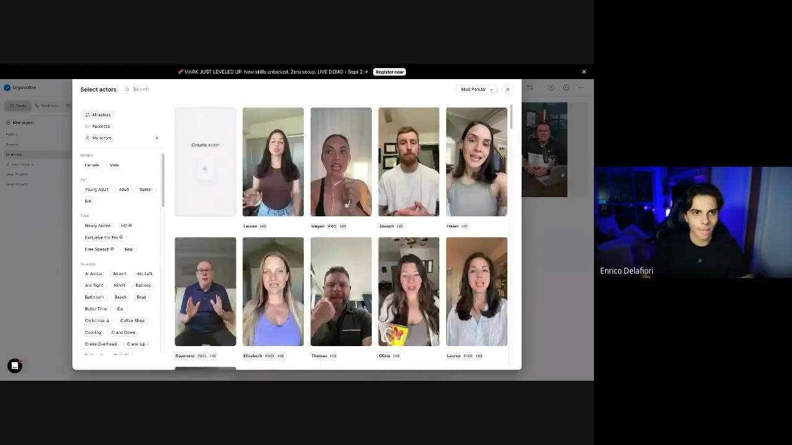
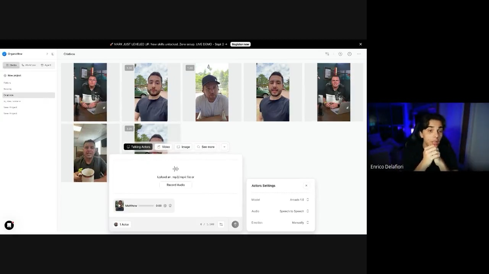
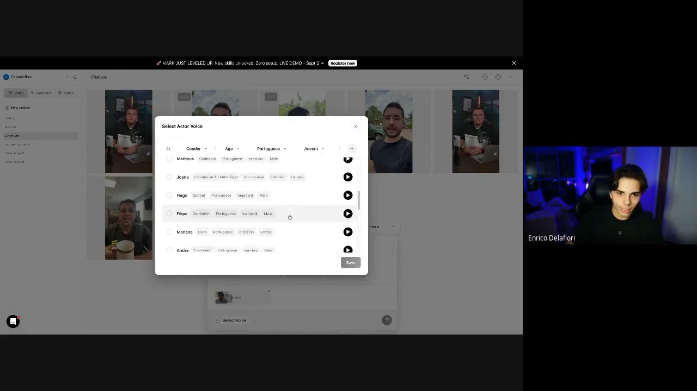
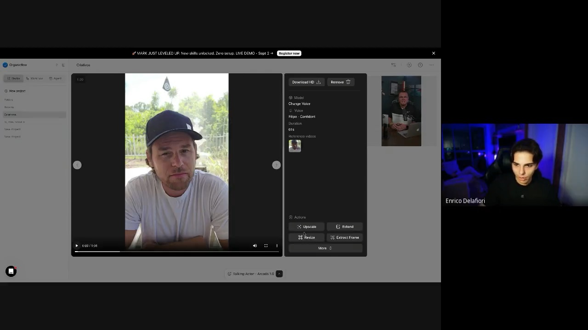

# Leon Group · contexto completo para produzir os criativos

Os seis documentos de contexto deste pacote, num arquivo só,
incluindo o passo a passo da produção no Arcads.
Os roteiros vêm à parte, um por arquivo, em `roteiros-um-a-um/`.

# Pacote de criativos · Leon Group

Gerado em 2026-09-12 a partir dos arquivos de origem do projeto.

Você é a inteligência artificial que vai **produzir os vídeos** destes
roteiros. Este pacote é tudo que você precisa saber. Ele foi escrito para
alguém que não sabe nada sobre este negócio.

## As sete regras, antes de qualquer coisa

Este pacote foi auditado contra estas sete regras, e ele não pode ser gerado se
quebrar qualquer uma. **Elas valem também para tudo que VOCÊ produzir a partir
daqui:**

1. **Zero cliente inventado**
2. **Zero depoimento falso**
3. **Zero resultado atribuído à Leon Group**
4. **Zero promessa de faturamento ou de primeiro lugar no Google**
5. **Zero sugestão de escritório ou equipe americana**
6. **Zero número em dólar sem fonte declarada**
7. **Zero travessão** (o tracinho longo separando frase, em texto nenhum)

O porquê de cada uma está em `03-REGRAS-INEGOCIAVEIS.md`. Duas delas têm
consequência jurídica, não são preferência de estilo.

Se um pedido que você receber esbarrar em alguma delas, **não cumpra o pedido:
diga qual regra ele quebra.**

## Como usar isto numa IA de navegador (ChatGPT, Gemini, Claude)

**Dois passos, e a ordem importa:**

1. **Suba `CONTEXTO-COMPLETO.md` uma vez.** São os cinco documentos de contexto
   num arquivo só, cerca de 9 mil tokens. Cabe folgado e é lido inteiro.
2. **Depois suba um roteiro por vez**, de `roteiros-um-a-um/`. Cada arquivo tem
   2 a 3 mil tokens.

**Não suba `05-ROTEIROS-MASSACHUSETTS.md` esperando fidelidade palavra por
palavra.** Ele tem cerca de 70 mil tokens, e arquivo desse tamanho numa IA de
navegador deixa de ser lido inteiro: a ferramenta passa a buscar trechos. Para
ler o conjunto e escolher por onde começar, ele serve. Para produzir um vídeo
com a fala exata, use o arquivo individual do roteiro.

**Não suba o `.zip`.** A maioria das IAs de navegador só abre zip dentro de um
sandbox de código, o que funciona mal para absorver contexto. Suba os arquivos
soltos.

## Leia nesta ordem

| Arquivo | O que é | Quando usar |
|---|---|---|
| `CONTEXTO-COMPLETO.md` | **Comece aqui.** Os cinco documentos abaixo, juntos | Upload 1, sempre |
| `roteiros-um-a-um/` | Um arquivo por roteiro, pequeno e lido inteiro | Upload 2, um por vez |
| `01-NEGOCIO-PUBLICO-MERCADO.md` | Quem anuncia, para quem, em que mercado | Sempre, antes de tudo |
| `02-OFERTA-PRODUTO-ENTREGA.md` | O que é vendido, por quanto, o que é entregue, o mecanismo | Sempre |
| `03-REGRAS-INEGOCIAVEIS.md` | O que **nunca** pode ser dito, e por quê | Sempre. Esta é a mais importante |
| `04-COMO-PRODUZIR-OS-VIDEOS.md` | Ferramenta, tetos de caracteres, áudio, formato | Na hora de gerar |
| `05-ROTEIROS-MASSACHUSETTS.md` | Os 20 roteiros da primeira leva | Na hora de gerar |
| `06-ROTEIROS-LOS-ANGELES.md` | Os 6 roteiros da segunda leva | Na hora de gerar |
| `07-PRODUZIR-NO-ARCADS.md` | **Como produzir os vídeos no Arcads**, passo a passo, com os parâmetros exatos da ferramenta | Na hora de gerar |
| `arcads-passo-a-passo/` | As quatro telas do Arcads, da escolha do ator ao download | Junto com o 07 |
| `roteiros-massachusetts.json` | Os mesmos 20, estruturados, para importar | Importação automática |
| `roteiros-los-angeles.json` | Os mesmos 6, estruturados | Importação automática |
| `identidade/` | Logo, símbolo e paleta, para as cartelas na tela | Na edição |
| `referencia-visual/` | Frames do criativo de referência, **com a legenda que diz o que neles não pode ser copiado** | Para calibrar o visual. Leia o `.md` de lá antes de olhar as imagens |

## O trabalho, em uma frase

São **26 roteiros escritos e prontos**. Falta transformá-los em vídeo.
Roteiro escrito não é criativo pronto, e é exatamente esse o pedaço que falta.

## Três coisas que você precisa entender antes de começar

**1. O roteiro é verbatim.** O campo com a fala é palavra por palavra. Não
reescreva, não melhore, não "deixe mais natural". Cada frase foi medida para
caber no teto de caracteres da ferramenta e para dizer o ICP nas duas primeiras
frases. Mudar uma palavra pode estourar o teto ou apagar o filtro de público.

**2. As pessoas nos roteiros não são clientes.** Wilson, Cleiton e Sidnei são
personagens que **ilustram o problema do mercado**. Nenhum deles é cliente da
Leon Group, nenhum dá depoimento. Essa distinção é o que separa dramatização
legítima de testemunho fabricado, que é crime de propaganda nos Estados Unidos.
Está detalhado em `03-REGRAS-INEGOCIAVEIS.md`, e é inegociável.

**3. Dezesseis atores diferentes, não um.** Dezesseis vídeos com o mesmo rosto
na mesma parede saturam o público em uma semana. Cada roteiro traz o filtro do
ator que ele pede.

## Dois pontos ainda em aberto no negócio

Estes não estão resolvidos. Nenhum roteiro depende deles (nenhum roteiro cita
preço), mas se você for escrever copy nova, precisa saber:

- **O preço tem duas versões vivas.** A página pública de planos diz
  US$ 2.500 / 4.500 / 7.500. A decisão comercial de 2026-09-11 diz front de
  US$ 5.000 com piso de negociação em US$ 2.500. Estão em
  `02-OFERTA-PRODUTO-ENTREGA.md`, lado a lado. **Não anuncie preço** até isso
  ser resolvido por uma pessoa.
- **Território.** A segmentação é os Estados Unidos inteiros, filtrada por
  idioma português, não por cidade. As duas levas de roteiro são de cidades
  específicas por outro motivo: concretude. Explicado no arquivo 01.

---

# 1 · O negócio, o público e o mercado

## Quem anuncia

**Leon Group.** Slogan: **Built to Lead.**

Agência enxuta de geração de leads, operada por **uma pessoa**: o Rodrigo,
brasileiro, operando do Brasil. Não há escritório nos Estados Unidos, não há
equipe, e a agência é nova, sem cliente fechado até agora.

Isso não é um detalhe de bastidor, é uma restrição de roteiro: nada no vídeo
pode sugerir presença física nos Estados Unidos, equipe grande ou carteira de
clientes. O motivo está no arquivo 03.

## A história, na voz da própria marca

A Leon Group nasceu de uma conta que não fecha: brasileiro na construção civil nos Estados Unidos fatura bem, executa bem, tem cliente satisfeito, e ainda assim não sabe de onde vem o trabalho do mês que vem.

Quem administra a obra e quem executa a obra vivem do mesmo lugar: indicação. Nenhum dos dois tem canal de venda próprio. Não é falta de competência técnica, é falta de estrutura comercial, e estrutura comercial é uma coisa que se constrói.

É essa a brecha que a Leon Group ocupa. Não vendemos visibilidade solta nem post bonito. Construímos as três coisas que fazem cliente novo chegar sem depender de indicação: presença que passa confiança, aquisição que traz gente pedindo orçamento e processo comercial que não deixa lead esfriar.

Somos uma agência nova, e preferimos dizer isso do que inventar história. O nome carrega o que a gente quer entregar: Built to Lead, construído para liderar. Não pra aparecer, não pra postar bonito, mas pra colocar a sua empresa na frente na sua região.

## Para quem vende

Brasileiros **donos ou operadores de empresas de construção e home services nos
Estados Unidos**.

**Dois perfis, e o primeiro é a maioria:**

| Perfil | O que é | Fatia do mercado | Faturamento |
|---|---|---|---|
| **Subcontractor** | O pedreiro contratado. Executa a obra, não assina o orçamento | 85 a 90% | US$ 10 a 20 mil por mês |
| **Contractor** | O dono da obra. Fecha com o cliente final | 10 a 15% | US$ 30 a 60 mil por mês |

**Fonte desses números:** levantamento de mercado apresentado na mentoria que o
Rodrigo cursa. Uma versão anterior do mesmo material citava faixas mais altas
(US$ 15 a 30 mil e US$ 70 a 100 mil). **Não são medição da Leon Group e não
podem ser ditos em anúncio como dado próprio.** Servem para você entender com
quem está falando, não para virar número na tela.

Os dois já têm A-Number, o equivalente americano ao CNPJ.

**O subcontractor querendo virar contractor é o alvo central dos roteiros.**
É a pessoa que executa melhor que o concorrente e ganha menos que ele, porque o
concorrente aparece no Google e ele não.

## Quem é essa pessoa, de verdade

Homem, 30 a 55 anos, veio do Brasil, aprendeu o ofício na mão. Executa muito
bem. Cobra bem menos do que quem vende o mesmo serviço com o nome na porta.
Consegue trabalho por indicação e por WhatsApp de conterrâneo. Não tem site, ou
tem um que não abre direito no celular. Tem menos de dez avaliações no Google,
quando tem perfil. Nunca contratou marketing, ou contratou uma vez, pagou, e
não recebeu nada.

**O que ele sente, na ordem em que sente:** mês bom seguido de mês morto; ver o
concorrente que trabalha pior aparecer primeiro no Google; mandar orçamento e o
cliente sumir; a sensação de que está sempre recomeçando.

## As quatro dores, do jeito que a marca as nomeia

- **Cliente novo só chega por indicação.** Sem fila, sem previsão, sem controle. O mês bom depende de quem lembrou de você.
- **Tráfego pago assusta, e com razão.** Investir milhares de dólares por semana em Meta e Google sem processo comercial montado é queimar dinheiro.
- **O anúncio que mais converte pede license.** O Google Local Service Ads exige licença que a maior parte dos contractors brasileiros não tem. Fica de fora do canal mais direto.
- **Quem pesquisa sua empresa não acha nada.** O cliente americano procura o nome antes de ligar. Se não achar site, Google Business Profile e avaliação, ele escolhe outro.

## Os nichos

Construção e home services. Nove subnichos, todos dentro do escopo:

**Flooring** (90% dos clientes; subtipos hardwood, carpet, staircase, tile,
vinyl, laminate, epóxi), **Painting**, **Remodeling** (interior, exterior,
bathroom, kitchen), **Carpentry**, **Cabinets**, **Roofing**, **HVAC**,
**Gutter**, **Framing**.

Fora do escopo por ticket baixo: house cleaning, carpet cleaning, window tint,
car detail.

## Território: os Estados Unidos inteiros

Esta é a parte que mais confunde quem chega agora, então vale devagar.

**A segmentação da campanha é o país inteiro, filtrada por idioma português,
não por cidade.** Restringir a área encolhe o público e encarece a entrega. O
filtro real é o idioma: quem fala português e trabalha com construção nos
Estados Unidos.

**Mas os roteiros são de cidades específicas.** Vinte se passam em
Massachusetts (Everett, Malden, Framingham, Waltham, Medford, Revere, Quincy,
Lynn, Somerville) e seis em Los Angeles (Van Nuys, North Hollywood, Burbank,
Glendale, Pasadena, Long Beach, Inglewood, Torrance, Pomona).

Isso é de propósito. Uma história concreta converte mais que uma genérica:
"Wilson instala piso em Waltham" prende mais do que "um contractor em algum
lugar". A cidade é o detalhe que faz a história parecer real, não um recorte de
público.

**Nunca estreite a segmentação para uma região.** De onde os leads vêm se lê
depois, no CRM.

## O tamanho do mercado

Milhões de brasileiros nos Estados Unidos na construção civil, com
baixíssima concorrência direta no serviço que a Leon Group vende.

## O número de contato

**+1 213 396 0014** (área 213, Los Angeles), ativo no WhatsApp Business, com
atendimento nacional. É o número que aparece nas cartelas e nos CTAs.

---

# 2 · A oferta, o produto, a entrega e o mecanismo

Este é o arquivo que diz **o que a Leon Group vende de verdade**. Nada além do
que está aqui pode ser prometido em anúncio.

## A promessa central

> Presença, aquisição e processo comercial para brasileiros que têm empresa de construção e home services nos Estados Unidos. Sem depender de tráfego pago e sem precisar de license.

Duas coisas nessa frase carregam o peso, e as duas são diferenciais reais:

- **Sem depender de tráfego pago.** O cliente não precisa queimar US$ 4 a 6 mil
  por semana em Meta e Google para começar a receber contato. (Essa faixa vem do
  levantamento da mentoria sobre o que o mercado gasta, não de medição da Leon
  Group. Não usar como número na tela.)
- **Sem precisar de license.** O Google Local Service Ads, que é o canal mais
  direto, exige licença que cerca de 90% dos contractors brasileiros não tem.
  O método da Leon Group não passa por lá.

## O mecanismo único: a ordem

**O mecanismo não é uma ferramenta nova, é uma ordem de execução.** É isso que
diferencia a Leon Group de agência que vende post bonito ou tráfego solto.

A ordem é:

1. **Diagnóstico**
   Ligação curta pra entender o que você faz, onde atende, como o cliente chega hoje e o que dá pra melhorar primeiro. Se não fizer sentido, a gente fala na hora.
2. **Marca e presença** · `5 dias úteis`
   Identidade, perfil e Google Business Profile no ar. É a base: sem isso, todo dólar de anúncio vaza.
3. **Site e conteúdo** · `Mesma janela`
   Página em inglês publicada, doze posts e quatro destaques prontos, com a sua obra e a sua região.
4. **Aquisição** · `Contínuo`
   Lead cai direto no WhatsApp. A regra é ligar em menos de um minuto: velocidade fecha mais que argumento.
5. **Processo comercial** · `Contínuo`
   CRM com régua de temperatura e follow-up. Nenhum lead sai do funil sem dizer explicitamente que não quer.
6. **Tráfego pago** · `Última etapa`
   Aí sim: Google Ads em search e Meta Ads. É a última etapa de propósito. Com presença no ar, site convertendo e follow-up rodando, o mesmo dólar de anúncio rende muito mais.

**O tráfego pago entra por último, de propósito.** Esta é uma decisão firmada e
o site diz isso abertamente. Anúncio apontando para presença fraca, site que não
converte e follow-up que não existe é o jeito mais caro de não vender nada. Com
a casa arrumada primeiro, o mesmo dólar de anúncio rende muito mais.

Essa inversão é contraintuitiva para o mercado (todo mundo vende tráfego
primeiro) e por isso ela é um ângulo forte de criativo. Vários roteiros giram em
torno dela.

## O que é entregue, serviço por serviço

### Marca e presença
*Base*

Identidade, logo e perfil no padrão de empresa americana consolidada. O primeiro filtro do cliente é o que ele vê antes de falar com você.

### Google Business Profile
*Busca local*

Perfil criado e otimizado do jeito certo: categoria, área de atendimento, serviços, fotos e informação completa. É o que aparece quando alguém busca sua obra na sua cidade.

### Site em inglês que converte
*Conversão*

Página própria feita para o cliente americano decidir: serviço claro, região atendida, obra mostrada e um caminho direto para pedir orçamento.

### Estratégia de avaliação
*Reputação*

Roteiro, momento e acompanhamento para pedir avaliação de cliente real depois de cada obra entregue. Reputação se constrói com cliente que existe.

### Conteúdo e Instagram
*Autoridade*

Doze publicações e quatro destaques com linha editorial definida, feitos para o dono de casa entender o que você faz e por que confiar.

### Aquisição e processo comercial
*Motor*

Atendimento no WhatsApp, qualificação e CRM com régua de follow-up. Lead que chega e não é trabalhado é dinheiro jogado fora.

### Tráfego pago: Google Ads e Meta Ads
*Última etapa*

Search no Google Ads e campanha no Meta Ads. Entra por último de propósito: anúncio em cima de presença fraca e sem follow-up é o jeito mais caro de não vender nada.

## Os planos e os preços

⚠ **ATENÇÃO: o preço tem duas versões vivas e isso não está resolvido.**

**Versão A, a que está publicada na página de planos:**

### Presença Local · US$ 2.500  ← **é este o alvo**

US$ 833 por mês, 3 meses. Você existe no Google, tem site que converte e avaliação para mostrar. É o que 9 de 10 contractors precisam primeiro.

*Fonte: página pública de planos da Leon Group.*

- Logo em três versões, se você ainda não tem
- Site no ar, com telefone clicável e todas as cidades que você atende
- Google Meu Negócio otimizado do zero: categoria, área, serviços, fotos
- Sistema de avaliação montado: link direto, QR code e 20 modelos de pedido em inglês, um por serviço e cidade
- 12 posts e 4 destaques do Instagram, com as artes finalizadas
- Tudo em 5 dias úteis, com reunião de entrega
- 3 meses de acompanhamento no WhatsApp

### Presença + Conteúdo · US$ 4.500

US$ 1.500 por mês, 3 meses. Para quem já aparece e quer sair na frente. Mantém o perfil vivo mês a mês, que é o que o Google recompensa.

*Fonte: página pública de planos da Leon Group.*

- Tudo do Presença Local
- 8 posts novos por mês, com as artes
- Acompanhamento da coleta de avaliação a cada trimestre, com meta e revisão do processo
- Publicação semanal no perfil do Google
- Uma página por serviço, com o termo que a pessoa digita
- Google Search Console configurado e relatório mensal do que trouxe visita

### Aquisição · US$ 7.500

US$ 2.500 por mês, 3 meses. Para quem já tem presença montada e quer volume. Anúncio apontando para uma casa arrumada, e não para uma obra.

*Fonte: página pública de planos da Leon Group.*

- Tudo do Presença + Conteúdo
- Campanha de Google Ads Search montada e gerenciada
- Campanha de Meta Ads montada e gerenciada
- Acompanhamento semanal de custo por contato
- Página de captura própria, separada do site

**Por prazo de contrato:**

**Presença Local**  *(fonte: página pública de planos)*

| Prazo | Total | O que muda |
|---|---|---|
| 3 meses | US$ 2.500 | A construção completa mais 3 meses de acompanhamento no WhatsApp. |
| 6 meses | US$ 4.500 | Mais 3 meses de acompanhamento, e uma rodada nova de 20 avaliações no 4º mês. |
| 12 meses | US$ 8.000 | Acompanhamento o ano todo, revisão do processo de avaliação por trimestre e revisão do perfil a cada 3 meses. |

**Presença + Conteúdo**  *(fonte: página pública de planos)*

| Prazo | Total | O que muda |
|---|---|---|
| 3 meses | US$ 4.500 | A construção completa, mais 8 posts por mês e o relatório mensal. |
| 6 meses | US$ 8.000 | O mesmo ritmo por 6 meses, com uma página nova de serviço no 4º mês. |
| 12 meses | US$ 14.000 | O ano todo, com uma página nova de serviço por trimestre. |

**Aquisição**  *(fonte: página pública de planos)*

| Prazo | Total | O que muda |
|---|---|---|
| 3 meses | US$ 7.500 | A construção completa, o conteúdo mensal e as campanhas montadas e gerenciadas. |
| 6 meses | US$ 13.500 | Seis meses de gestão, com teste de criativo a cada mês. |
| 12 meses | US$ 24.000 | O ano todo de gestão, com escala do que estiver funcionando. |

**Versão B, a decisão comercial de 2026-09-11:** front de **US$ 5.000**, com
**piso de negociação em US$ 2.500**. A lógica é abrir mais caro e negociar para
baixo, nunca abrir no piso. No pior caso, US$ 2.000 de recorrência mensal.

**Restrição de cobrança:** o link do WHOP está limitado a **US$ 2.500 por
cobrança**. Valor acima disso precisa ser partido.

**O que fazer com isso:** nenhum dos 26 roteiros cita preço, e isso foi
verificado. **Não introduza preço em criativo nenhum** até uma pessoa resolver
qual versão vale.

## O prazo e o formato da entrega

- **5 dias úteis** para a construção completa, com **reunião de entrega no
  quinto dia**
- Depois disso, **3 meses de acompanhamento** no WhatsApp
- **Os arquivos originais e todos os logins ficam com o cliente.** A agência não
  guarda acesso. Esse ponto responde direto ao medo de quem já foi abandonado
  por agência antes

## A profundidade da entrega, em números

A otimização é auditada contra um checklist de **42 itens**,
o mesmo vocabulário usado no diagnóstico gratuito:

- **gbp**: 16 itens (13 obrigatórios)
- **site**: 13 itens (11 obrigatórios)
- **instagram**: 6 itens (6 obrigatórios)
- **logo**: 3 itens (3 obrigatórios)
- **geral**: 4 itens (4 obrigatórios)

Cada item tem o passo a passo escrito. Não é lista de conferência genérica, é a
régua da entrega.

## A oferta de entrada: o diagnóstico gratuito

**É a isca, e ela é real.** Um documento **por escrito**, em PDF na identidade
da marca, avaliando o Google Business Profile, o site e as avaliações do lead,
item por item, com o estado de cada um (feito, parcial, falta, não se aplica).

Isso importa para o criativo por dois motivos:

1. **É trabalho de verdade, não isca falsa.** Quando alguém pedir, o documento
   é entregue mesmo. Vários roteiros prometem isso em texto, e a promessa tem
   que se sustentar.
2. **É o que o CTA pede.** O criativo não vende o pacote e não cita preço. Ele
   pede uma conversa no WhatsApp em troca de um diagnóstico gratuito e por
   escrito. Essa é a única conversão que o vídeo precisa produzir, e é por isso
   que a indefinição de preço não trava a produção dos vídeos.

## O processo comercial, depois do clique

O vídeo entrega o lead no WhatsApp. Dali em diante:

- **A regra é ligar em menos de um minuto.** Velocidade fecha mais que argumento
- Qualificação, depois call, depois o diagnóstico apresentado ao vivo
- CRM com régua de temperatura e follow-up. Nenhum lead sai do funil sem dizer
  explicitamente que não quer
- **A analogia interna de vendas:** "a agência é uma consultoria médica, ouve,
  ouve, ouve, e no final entrega a receita." O cliente não pode sentir que você
  quer vender

## As doze funções

A agência é operada por uma pessoa apoiada em processo e automação, e cobre doze
funções. **Isto é escopo de trabalho, nunca contagem de funcionários.** Dizer ou
sugerir que a Leon Group tem doze pessoas é mentira.

| Função | O que faz |
|---|---|
| Gestor de projeto | Cronograma, prazo e responsável por cada entrega. Você sabe o que está sendo feito e quando fica pronto. |
| Head comercial | Desenha o processo de venda: o que perguntar, quando ligar, como conduzir até o fechamento. |
| Especialista em Google Meu Negócio | Perfil, categoria, área de atendimento, serviços e fotos. É a peça que decide se você aparece na busca da sua cidade. |
| Especialista em SEO | Estrutura do site, palavra-chave, página por serviço e por região. Aparecer sem pagar por clique é o que segura o custo lá embaixo. |
| Copywriter | Texto do site, do anúncio, do perfil e da mensagem. Em inglês, no jeito que o cliente americano lê e entende. |
| Designer | Marca, identidade, peça de anúncio e material do perfil. O primeiro filtro do cliente é visual, e ele julga em segundos. |
| Social media | Linha editorial, calendário e publicação. Perfil parado passa a mesma mensagem que perfil que não existe. |
| Editor de vídeo | Corte, legenda e formato vertical a partir da obra que você já filma no celular. Vídeo de obra real converte mais que imagem de banco. |
| I.A. e automação | Resposta imediata, qualificação e follow-up sem esquecimento. O que é repetitivo vira máquina e para de depender de memória. |
| Head de performance | Lê o número: quanto custa o lead, quantos viram orçamento, quantos viram obra. Sem isso, investir em anúncio é achismo caro. |
| Gestor de tráfego pago | Google Ads em search e Meta Ads. Só entra na última etapa, quando presença e processo já estão de pé. |
| Suporte integral | Canal direto em português, do primeiro dia ao fim do contrato. Sem fila, sem ticket e sem intermediário. |

> A Leon Group é enxuta de propósito. Quem executa se apoia em processo, ferramenta e automação para cobrir essas funções sem inchar o custo, e esse custo menor é o que faz o preço fechar pra você. Você contrata resultado, não crachá.

## Perguntas que o público faz, e as respostas oficiais

**Preciso investir em tráfego pago?**

Não é obrigatório, e é justamente esse o ponto. A base do trabalho (marca, Google Business Profile, site, avaliação e conteúdo) traz cliente pela busca local e pela sua presença, sem você colocar dinheiro em anúncio. Google Ads e Meta Ads entram na última etapa, quando já existe estrutura pra sustentar o investimento, e você decide se quer.

**Preciso de license?**

Não para o que a gente constrói. O Google Local Service Ads exige licença, e é exatamente por isso que ele fica de fora do caminho principal. Presença, busca local e conteúdo funcionam sem license.

**Em quanto tempo eu vejo resultado?**

Sua presença fica no ar em até cinco dias úteis depois do formulário preenchido, e isso é prazo, não estimativa. Já quando entra o primeiro cliente novo, honestamente, depende da sua região, do seu nicho e da concorrência. Quem te promete data pra isso está adivinhando.

**Com quais serviços vocês trabalham?**

Flooring (hardwood, tile, vinyl, laminate, carpet, escada, epóxi), painting, remodeling, cabinets, carpentry, roofing, gutters, HVAC e framing. Ficamos fora de house cleaning, carpet cleaning e window tint: o ticket não cobre o custo de aquisição, e a gente prefere dizer isso do que aceitar e não entregar.

**Quanto custa?**

O preço sai depois do diagnóstico, porque depende do que você já tem e do que precisa ser construído. Não tem pacote fechado na prateleira e não tem cobrança escondida. Você recebe escopo, prazo e valor por escrito antes de decidir qualquer coisa.

**Vocês garantem resultado?**

Garantimos método, execução e transparência: você sabe o que está sendo feito, quando e por quê. Faturamento e posição no Google não dependem só de nós, dependem do mercado, da sua região e da sua operação. Quem garante número está vendendo, não trabalhando.

**Eu não falo inglês. É problema?**

Nenhum. O atendimento com você é todo em português. O material que vai pro seu cliente (site, perfil, conteúdo, anúncio) é feito em inglês, no padrão que o cliente americano espera ler.

**Vocês estão nos Estados Unidos?**

A operação é remota e o atendimento é em português. Preferimos deixar isso claro em vez de fingir endereço americano: o que importa é o material que chega ao seu cliente estar no padrão de lá, e é assim que a gente faz.

---

# 3 · Regras inegociáveis

**Se você ler um arquivo só deste pacote, leia este.**

**As sete, em uma linha cada:** zero cliente inventado, zero depoimento falso,
zero resultado atribuído à Leon Group, zero promessa de faturamento ou de
primeiro lugar no Google, zero sugestão de escritório ou equipe americana, zero
número em dólar sem fonte declarada, e nada de travessão.

As regras abaixo não são preferência de estilo. Algumas são consequência
jurídica, outras são decisão comercial já tomada. Um vídeo que quebre qualquer
uma delas não pode ir ao ar, por melhor que esteja.

## O que NUNCA pode aparecer

### 1. Depoimento, cliente ou resultado inventado

A Leon Group **não tem cliente fechado até hoje**. Portanto:

- Nenhuma pessoa no vídeo pode ser apresentada como cliente da Leon Group
- Nenhuma pessoa pode dar depoimento sobre o serviço
- Nenhum resultado pode ser atribuído a um cliente
- Nenhuma contagem de clientes pode ser citada

**Por quê:** depoimento fabricado em anúncio pago no mercado americano cai na
regra de testemunhos da FTC, com multa civil por violação, e o Meta derruba o
anúncio e pode derrubar a conta junto.

**Como os roteiros resolvem isso, e você precisa preservar:** cada anúncio conta
a história de uma pessoa com nome, ofício e cidade. Wilson instala piso em
Waltham. Cleiton faz banheiro entre Everett e Malden. Sidnei tem seis avaliações
contra duzentas e quatorze do concorrente.

**Esses personagens ilustram o problema do mercado, e a agência entra depois.**
Nenhum é apresentado como cliente, nenhum dá depoimento. É exatamente isso que
separa dramatização legítima de testemunho fabricado. Não aproxime os dois.

### 2. Presença física nos Estados Unidos

A operação é remota, do Brasil. Nada pode sugerir escritório, equipe ou
endereço americano.

**Por quê, e este motivo é comercial antes de ser ético:** a própria aula da
mentoria documenta o caso do mentorado que viu o cliente, com o cartão na mão
pagando cinco mil dólares, perguntar "você tá no Brasil?" e desistir. Mentir
sobre isso cria uma bomba-relógio na call.

### 3. Promessa de faturamento ou de posição no Google

Nada de "você vai faturar X", "você vai aparecer em primeiro lugar", "garanto
tantos leads". Sem base verificável, não se promete.

### 4. Equipe grande

As doze funções são **escopo de trabalho**. Nunca headcount. A agência é uma
pessoa apoiada em processo e automação, e o site diz isso abertamente.

### 5. Valor em dólar sem fonte

Todo número em dólar que aparecer na tela ou na fala precisa de fonte declarada
no frame. Os roteiros já trazem isso no campo `verificar` de cada um. Não
invente número novo, e não reaproveite número de Massachusetts num roteiro de
Los Angeles: ticket de Boston não é ticket de Los Angeles.

### 6. B-roll sem origem declarada

Nenhuma imagem de banco sem licença. Nenhuma obra de terceiro apresentada como
obra do cliente. Cada plano de apoio precisa de origem declarada.

## A regra de escrita que vale em todo texto

**Nada de travessão.** O tracinho longo separando frase não entra em lugar
nenhum: fala, legenda, cartela, descrição, título. É regra permanente do dono do
negócio, dada em 2026-09-06. Usar vírgula, dois-pontos, ponto ou parêntese no
lugar. Hífen de palavra composta (pré-venda, follow-up) continua normal.

## O tom de voz

**Confiante, direto, profissional, claro, próximo de contractor brasileiro nos
Estados Unidos.** Conversa de estacionamento, não apresentação de palco.

**Evitar sempre:**

- "Vamos juntos!"
- "Caro cliente"
- Jargão de guru: "alavancar", "sinergia", "mindset", "destravar"
- Emoji em contexto formal
- Entusiasmo de vendedor. O ator precisa parecer alguém que já pegou no pesado
  e fala reto, não modelo de comercial

## O idioma

**Os roteiros são em português**, porque o público é brasileiro morando nos
Estados Unidos e a campanha é filtrada por idioma português. Não traduza para
inglês. Termos técnicos do ofício ficam em inglês, do jeito que o público usa
no dia a dia: engineered hardwood, subcontractor, drywall, estimate.

## A identidade visual nas cartelas

| Uso | HEX |
|---|---|
| Preto, fundo de cartela | `#171717` |
| Marfim, texto sobre preto | `#F7F3EA` |
| Laranja, ênfase e CTA | `#E65A19` |
| Laranja escuro | `#C44712` |
| Areia | `#E9E1D6` |
| Cinza de apoio | `#68645E` |

**O símbolo da marca é uma cabeça de leão integrada à letra O de LEON.** Nunca
usar versão sem o leão. Os arquivos estão em `identidade/`.

**Direção estética:** sofisticada, limpa, bastante espaço negativo, laranja só
como ênfase e nunca como fundo dominante. **Evitar:** 3D, brilho, sombra
pesada, ornamento em excesso e aparência genérica de IA.

---

# 4 · Como produzir os vídeos

## O que existe e o que falta

26 roteiros escritos. **21 para ator de inteligência
artificial** e **5 para o Rodrigo gravar ele mesmo**, que custam zero
e por isso vêm primeiro.

Os vídeos **não existem**. É esse o trabalho.

## A ferramenta e o teto de caracteres

A ferramenta prevista é o **Arcads**. Cada modelo tem um teto:

| Modelo | Teto | Para |
|---|---|---|
| Omnihuman 1.5 | 400 caracteres | O mais expressivo, gesto de corpo inteiro |
| Audio Driven | 600 caracteres | 45 segundos ou mais. É onde quase tudo aqui roda |
| Arcads 1.0 | 1500+ caracteres | Script longo, evitado de propósito |

**Todos os scripts cabem em 600 caracteres.** O maior tem 587. Isso dá 40 a
45 segundos com respiro e **uma geração só, sem emenda**. Cada roteiro traz o
modelo recomendado no campo próprio, com o motivo.

## O áudio

**`Settings > Audio > Speech to Speech`, nunca Text to Speech.**

Grave a própria voz com os respiros no lugar e deixe a ferramenta trocar a voz.
Text to Speech entrega leitura, não fala, e o público reconhece na hora. Cada
roteiro traz uma orientação de áudio específica: onde acelerar, onde parar, onde
a frase cai.

## A escolha do ator

**Na biblioteca do Arcads você escolhe o ator, não descreve.** Por isso cada
roteiro traz um filtro pronto: `Add Actors`, gênero, faixa etária, cenário.

**Os 21 atores precisam ser pessoas diferentes em lugares diferentes**,
de trinta e um a quarenta e sete anos, em garagem, picape, obra, depósito e
cozinha em reforma. Dezesseis vídeos com o mesmo rosto na mesma parede saturam
o público em uma semana.

Em todos: procurar alguém que parece que já pegou no pesado e fala reto.
**Descartar** ator com sorriso de comercial, gesticulação de palestrante ou
fundo de escritório com plantinha.

## O formato de cada roteiro

Cada um tem um **prompt único, copiável de uma vez**, com quatro seções:

- **QUEM** a pessoa é, incluindo o filtro da biblioteca
- **ONDE** ela está
- **O QUE FALA**, palavra por palavra
- **O QUE NUNCA PODE APARECER**

Abaixo do prompt vem o **storyboard** daquele roteiro, em três colunas: tempo,
imagem, e o que aparece escrito na tela. **Os planos de apoio vivem na coluna
Imagem**, não em prompts separados. Se for gerar algum, a descrição da célula já
serve de prompt.

Nada além do prompt precisa ir para a ferramenta.

## A ordem de produção, e ela importa por dinheiro

O Arcads cobra **US$ 110 por 10 vídeos**, não tem teste grátis, e "não gostei do
resultado" **não é reembolsável**. (Preço de tabela da própria ferramenta,
apurado em 2026-09-09. Confira antes de comprar: preço de ferramenta muda.)
Então:

1. **Gravar primeiro os 5 do Rodrigo.** Custam zero
2. **Depois 1 no Arcads**, só para conferir o resultado
3. **Só então 3 ou 4 por vez**

Nunca gerar os dezesseis de uma vez.

## O que conferir antes de publicar qualquer um

Cada roteiro tem um campo `verificar` com a lista dele. Além disso, vale para
todos:

- Nenhuma afirmação proibida pelo arquivo 03 sobrou no vídeo
- Nenhum travessão na legenda nem na cartela
- Todo valor em dólar na tela tem fonte declarada
- O número de WhatsApp na cartela foi testado ponta a ponta antes de ir ao ar

---

# Arcads · manual técnico da ferramenta

Documento para ser entregue a uma inteligência artificial que vai **auxiliar na
produção de criativos em vídeo no Arcads**.

Só a parte técnica: interface, parâmetros, modelos, limites, planos e as
armadilhas. Sem estratégia de copy e sem roteiro, que entram depois.

**Duas origens, e elas não têm a mesma idade:**

| Origem | O que vem dela | Quando |
|---|---|---|
| Gravação de uma aula com a conta na tela | Os nomes dos campos, o passo a passo e os valores da interface | Versão antiga do produto |
| Print da tela de planos | Preços, créditos, limites e recursos por plano | Atual |

**Onde as duas divergem, o print manda.** Os pontos de divergência estão
marcados um a um.

---

## ⚠ Informação faltante, a ser preenchida depois

**Os roteiros ainda não existem neste documento.** Eles serão escritos do zero e
entregues em outro momento.

Portanto, **não assuma nada sobre**: quantidade de criativos, duração de cada
um, contagem de caracteres, quantos serão gerados por IA e quantos serão
gravados por pessoa, quais atores, qual voz, qual cenário, qual idioma.

**Quando os roteiros chegarem, a primeira tarefa é a verificação de caracteres
descrita na seção "Verificação obrigatória de caracteres", mais abaixo.** Até
lá, este documento é só o manual da ferramenta.

---

## 1. Os planos, e como eles realmente limitam a produção

Valores da tela de planos, cobrança **mensal**. Há um desconto de **30%** ativo
e um botão `YEARLY` com **20% OFF** por tempo limitado, que não está detalhado
aqui porque a tela lida estava em `MONTHLY`.

| | **Starter** | **Creator** (`MOST POPULAR`) | **Pro** |
|---|---|---|---|
| **Preço/mês** | **US$ 77** (de US$ 110) | **US$ 154** (de US$ 220) | **US$ 385** (de US$ 550) |
| **Créditos/mês** | 8.000 | 16.000 | 48.000 |
| **Segundos de AI Avatar falando** | **até 600** | até 1.200 | até 3.600 |
| **AI video clips** | até 50 | até 100 | até 300 |
| **AI Avatar Reactions** | não | até 100 | até 100 |
| **Natural AI Actors** | 300 | 1.000 | 1.500 |
| **Access to All Models** | sim | sim | sim |
| **Mark** (agente que monta anúncios ponta a ponta) | sim | sim | sim |
| **MCP** (conectar a Claude, Cursor e outros) | sim | sim | sim |
| **Workflows** (pipeline de vídeo automatizado) | **não** | sim | sim |
| **Remove background & AI captions** | **não** | sim | sim |
| **API access** | não | não | sim |
| **Team collaboration / seats** | não | não | assentos ilimitados grátis |
| **ElevenLabs** | não | não | integração |
| **Custom Actors** (clonar ator próprio) | não | não | sim |
| **Créditos não usados acumulam** | **não** | **não** | sim |
| **Slack e call direta com o time** | não | não | sim |
| **Imagens NanoBanana grátis/mês** | 200 | 1.000 | 3.000 |
| **Nota extra** | | | `Save 17% per video` |

Os três planos exibem o selo **`SEEDANCE 2.5 LATEST`**.

### O limite que morde primeiro

**Não é o preço, são os segundos.** O `Starter` dá **600 segundos de AI Avatar
falando por mês**. Traduzindo para produção:

| Duração do criativo | Quantos cabem em 600s |
|---|---|
| 30 segundos | 20 |
| 45 segundos | **13** |
| 60 segundos | 10 |

**E cada regeração consome de novo.** Um vídeo de 45 segundos que você gerou
três vezes até ficar bom custou 135 dos seus 600 segundos, não 45. Com dez
regerações espalhadas pelo mês, um terço do plano `Starter` foi embora sem
nenhum vídeo a mais no disco.

**O segundo limite é o número de clipes:** 50 no `Starter`. Também conta
tentativa, não só acerto.

**No `Starter` e no `Creator`, crédito não usado NÃO acumula.** Só o `Pro`
acumula. Então sobra de mês não vira reserva: evapora na virada.

### O que isto significa na prática

- **Teste caro é o que mata o plano**, não o volume final. Calibre os
  parâmetros em um vídeo e só depois rode o lote
- **Se a produção for concentrada**, assinar um mês do plano maior e cancelar
  pode custar menos que estourar o menor e ter que subir no meio
- **`Workflows` e `Remove background & add AI captions` só existem do `Creator`
  para cima.** Se legenda automática fizer parte do processo, o `Starter` está
  fora
- **Clonar ator próprio só no `Pro`**, via `Custom Actors`

---

## 2. A estrutura da conta

| Nível | O que é |
|---|---|
| **Workspace** | O espaço da conta, com nome próprio |
| **Projeto** | Pasta de trabalho. Existe `New project` na lateral |
| **Navegação lateral** | `Folders`, `Recents`, `Creations` |
| **Abas do topo** | `Studio` · `Workflow` · `Agent` |

As três abas do topo correspondem aos três modos do produto: **`Studio`** é a
geração manual descrita neste documento, **`Workflow`** é o pipeline
automatizado (do `Creator` para cima) e **`Agent`** é o `Mark`, que monta
anúncios ponta a ponta.

Dentro do `Studio`, a barra de ferramentas tem: **`Talking Actors`** · `Video` ·
`Image` · `See more`.

---

## 3. Passo a passo, do zero ao arquivo baixado

### Passo 1 · Escolher o ator

**Caminho:** aba `Talking Actors` → botão **`Add Actors`** → abre o modal
**`Select actors`**.

**Filtros do modal, com os rótulos exatos:**

| Grupo | Opções |
|---|---|
| Listas | `All actors` · `Favorites` · `My actors` |
| `Gender` | `Female` · `Male` |
| `Age` | `Young Adult` · `Adult` · `Senior` · `Kid` |
| `Type` | `Newly Added` · `HD` · `Exclusive For Pro` · `Free Speech` · `Real` |
| `Situation` | `AI Avatar`, `Airport`, `Arc Left`, `Arc Right`, `ASMR`, `Balcony`, `Bathroom`, `Beach`, `Boat`, `Bullet Time`, `Car`, `Christmas`, `Coffee Shop`, `Cooking`, `Crane Down`, `Crane Overhead`, `Crane Up`, e continua |
| Ordenação | `Most Popular` |
| Busca | Campo de texto no topo, busca por nome |

Cada ator traz selo **`HD`** ou **`PRO HD`**. O primeiro tile da grade é
**`Create actor`**.

**Como usar:** filtrar, ou buscar por nome com `All actors` ativo, selecionar,
**`Add`**.

**Ponto de atenção sobre `Situation`.** O filtro descreve **onde o ator está e
como a câmera se move**, não o que ele fala. `Car`, `Coffee Shop`, `Balcony` e
`Bathroom` são cenários; `Arc Left`, `Arc Right`, `Crane Up`, `Crane Down`,
`Crane Overhead` e `Bullet Time` são movimentos de câmera. Escolher um
movimento de câmera quando você queria um cenário é um erro fácil de cometer e
só aparece depois de gerar.

**A biblioteca varia por plano:** 300 atores no `Starter`, 1.000 no `Creator`,
1.500 no `Pro`. Um ator visto num plano pode não existir noutro.

---

### Passo 2 · Os parâmetros em Actors Settings

Painel **`Actors Settings`**, no lado direito.

**Três campos:**

| Campo | Valores observados | Observação |
|---|---|---|
| **`Model`** | `Arcads 1.0` | Ver a seção de modelos |
| **`Audio`** | `Text to Speech` ou **`Speech to Speech`** | **É o parâmetro que mais muda o resultado** |
| **`Emotion`** | `Manually` | |

### `Speech to Speech` versus `Text to Speech`

**`Text to Speech`:** você digita o texto e a ferramenta sintetiza a fala. É o
padrão, e é o que produz entonação robótica.

**`Speech to Speech`:** você sobe uma gravação de voz humana e a ferramenta
**troca o timbre pelo do personagem, preservando ritmo, pausa e entonação da
gravação original**.

A recomendação de quem demonstrou a ferramenta é categórica: **usar sempre
`Speech to Speech`**, porque com texto *"fica uma entonação zoada"*.

**A voz que sai não é a de quem gravou.** Perguntado diretamente se o vídeo
sairia com a voz do locutor, ele respondeu: *"Não, ele muda para voz do
personagem."* O que sobrevive da gravação é a **performance**, não o timbre.

**Consequência operacional:** com `Speech to Speech`, a qualidade do criativo
passa a depender de uma gravação humana bem feita. Não existe atalho: áudio
ruim entra, vídeo ruim sai.

---

### Passo 3 · O áudio

**Campo central**, com duas entradas:

- **`Upload an .mp3/.mp4 file`**
- **`Record Audio`**, gravação direto na página

Abaixo aparece a linha do ator selecionado com o tempo do áudio carregado (nome
do ator e `0:00` antes de subir o arquivo), o marcador **`1 Actor`**, o contador
de caracteres e o botão de gerar, à direita.

**Requisito técnico do áudio, e o motivo:** o áudio precisa estar limpo, sem
ruído de fundo. A justificativa dada é que **o Meta otimiza a entrega pela
transcrição do áudio e das imagens**, então ruído degrada a qualificação do
público que recebe o anúncio. Um microfone de entrada resolve; áudio de câmera
de celular em ambiente aberto, não.

---

### Passo 4 · Gerar

Com ator adicionado, parâmetros marcados e áudio subido, o botão de gerar fica
ativo no canto do painel de áudio.

**Cada geração consome segundos e um clipe da cota, dê certo ou não.**

---

### Passo 5 · Trocar a voz, quando o sotaque atrapalha

**O problema relatado:** atores da biblioteca dublados para outro idioma saem
*"com alguns acentos americanos"*, o que quebra a naturalidade.

**Caminho:** **`More`** → **`Change Voice`** → abre o modal **`Select Actor
Voice`**.

**Filtros do modal:** busca, `Gender`, `Age`, **idioma** (no exemplo,
`Portuguese`), `Accent`.

**Vozes em português observadas na biblioteca:**

| Voz | Característica | Variante | Gênero |
|---|---|---|---|
| `Matheus` | Confident | brazilian | Male |
| `Joana` | Informative & Educational | brazilian | Female |
| `Hugo` | Upbeat | standard | Male |
| `Filipe` | Confident | standard | Male |
| `Mariana` | Calm | brazilian | Female |
| `Andre` | Confident | brazilian | Male |

Repare na coluna **variante**: `brazilian` e `standard` são coisas diferentes.
`standard` tende ao português europeu ou neutro. **Para público brasileiro,
`brazilian` é a variante a preferir**, e vale ouvir as duas antes de fechar.

Cada voz tem **botão de play** para ouvir antes de aplicar. Seleciona e
**`Save`**.

**Ressalva:** a voz demonstrada como validada foi a `Filipe · Confident`, que é
`standard`, não `brazilian`. Ou seja, nem a escolha de quem ensina segue a regra
acima. Teste com ouvido próprio em vez de herdar a escolha.

**No plano `Pro` existe integração com ElevenLabs**, o que abre um catálogo de
vozes muito maior que essa lista.

---

### Passo 6 · A ficha do vídeo pronto e o download

**Painel da direita:**

| Campo | O que mostra |
|---|---|
| `Model` | O modelo usado. Vira `Change Voice` se a voz foi trocada |
| `Voice` | A voz aplicada, por exemplo `Filipe - Confident` |
| `Duration` | Duração final em segundos |
| `Reference videos` | Miniatura do áudio de referência que foi subido |

**Botões principais:** **`Download HD`** e `Remove`.

**Bloco `Actions`:**

| Ação | O que faz |
|---|---|
| `Upscale` | Aumenta a resolução |
| `Extend` | Estende a duração |
| `Resize` | Muda o formato ou proporção |
| `Extract Frame` | Extrai um quadro como imagem |
| `More` | Onde fica `Change Voice`, entre outras |

No rodapé fica o carimbo do que gerou aquele arquivo, no formato
`Talking Actor · <modelo>`.

**`Resize` é o caminho para as variações de formato** (9:16, 1:1, 16:9) sem
gastar uma geração nova, e vale confirmar se ele conta como clipe na cota.

---

## 4. Os modelos e os tetos de caracteres

**Esta é a seção mais desatualizada do documento, e a mais importante de
verificar antes de produzir.**

**Modelos e tetos registrados anteriormente:**

| Modelo | Teto de caracteres | Perfil |
|---|---|---|
| `Omnihuman 1.5` | 400 | O mais expressivo, gesto de corpo inteiro |
| `Audio Driven` | 600 | Peças de 45 segundos ou mais |
| `Arcads 1.0` | 1.500+ | Script longo |

**O que mudou:** a tela de planos atual exibe **`SEEDANCE 2.5 LATEST`** como
modelo mais recente nos três planos, e promete **`Access to All Models`** em
todos eles. `Arcads 1.0` era o modelo selecionado na aula. **A lista de modelos
e os tetos acima provavelmente estão defasados.**

**O contador observado na tela era `0 / 1,500`** e ele aparecia **mesmo com
`Audio: Speech to Speech` ligado**.

### A dúvida que precisa ser resolvida na tela, não no chute

Com `Speech to Speech`, o texto não é digitado: sobe-se um arquivo de áudio.
Então existem duas possibilidades, e ninguém documentou qual vale:

1. O contador de caracteres é **resíduo do modo `Text to Speech`** e fica
   inativo, com a duração do áudio virando o limite real
2. O contador **continua valendo** e o texto precisa ser informado em paralelo

**Não assuma nenhuma das duas.** Descubra na primeira sessão e anote.

---

## 5. Verificação obrigatória de caracteres

**Esta é uma tarefa sua, e ela vem antes de gerar qualquer vídeo.**

Quando os roteiros chegarem, **confira a copy de cada criativo, em cada formato,
contra o teto de caracteres do modelo que vai gerá-lo.** Copy que estoura o teto
é cortada no fim, e o corte cai justamente no CTA, que é a última coisa dita.

### O que fazer, na ordem

**1. Leia o teto na própria tela**, para cada modelo do menu `Model`. Não use os
números da tabela acima como verdade: eles são de uma versão anterior. Monte a
tabela real:

| `Model` | Teto na tela | Onde aparece |
|---|---|---|
| | | |

**2. Confira se o teto muda ao trocar de `Model`**, e se ele muda ao alternar
entre `Text to Speech` e `Speech to Speech`. Anote as quatro combinações.

**3. Conte cada copy** e monte esta tabela, uma linha por criativo e por
formato:

| Criativo | Formato | Modelo | Caracteres | Teto | Folga | Situação |
|---|---|---|---|---|---|---|
| | | | | | | cabe / estoura / no limite |

**Conte espaços e pontuação.** É assim que o campo conta.

**4. Sinalize tudo que passar de 90% do teto.** Copy a 95% do limite não tem
margem para ajuste de última hora, e qualquer palavra acrescentada na revisão
estoura.

**5. Para o que estourar, não corte por conta própria.** Aponte quanto passou,
mostre onde daria para encurtar sem perder o sentido, e **devolva a decisão para
quem escreveu**. Corte automático em copy publicitária tira justamente a parte
que faz vender.

**6. Estime a duração falada** de cada copy e some o total, para conferir contra
os segundos do plano. Uma estimativa razoável para fala com respiro é **2,6 a
2,9 caracteres por segundo**, mas **calibre com o primeiro áudio real gravado**:
cronometre a gravação, divida pelos caracteres e use o número medido.

**7. Se um formato exigir duração diferente** (corte de 15s para stories, 30s
para feed, 45s para o principal, por exemplo), **cada um é uma contagem
própria**. Não aprove uma copy para todos os formatos sem conferir cada teto.

---

## 6. Ressalvas que valem dinheiro ou tempo

**A ferramenta mudou desde o material de origem.** O passo a passo dos campos
segue válido, mas recursos novos apareceram: `Mark` (agente que monta anúncio
ponta a ponta), conexão **MCP** com Claude e Cursor, `Workflows`, `AI Avatar
Reactions` e imagens `NanoBanana`. Nenhum deles estava na aula. **Vale abrir a
conta e olhar antes de seguir o roteiro antigo à risca.**

**Geração não é reembolsável e não tem teste grátis.** O que saiu ruim consumiu
cota igual.

**Regeração é o maior ralo de cota.** Antes de gerar de novo, identifique qual
parâmetro causou o problema. Gerar de novo com os mesmos parâmetros esperando
resultado diferente gasta duas vezes pelo mesmo erro.

**Crédito não acumula no `Starter` nem no `Creator`.** Planejar produção
espalhada por dois meses num plano pequeno desperdiça a sobra do primeiro.

**A biblioteca de atores muda de tamanho por plano.** Um ator escolhido num
teste no plano maior pode não estar disponível se você descer de plano.

**Ator repetido satura o público.** Se muitos criativos forem ao ar na mesma
janela com o mesmo rosto no mesmo cenário, a audiência reconhece o padrão. Varie
ator e cenário entre as peças que rodam juntas.

**A variante da voz importa mais que o nome.** `brazilian` e `standard` soam
diferente para ouvido brasileiro, e o rótulo de característica (`Confident`,
`Upbeat`, `Calm`) muda a entrega tanto quanto a voz.

**`Emotion: Manually` foi o valor observado**, e existe porque há outro modo.
Vale descobrir quais são as opções e o que elas fazem antes de assumir que
manual é o melhor.

**Nunca gere o lote inteiro de uma vez.** Um vídeo primeiro, confira contra o
checklist abaixo, ajuste, e só então três ou quatro por vez.

---

## 7. Checklist do vídeo gerado, antes de aceitar

- [ ] A duração bate com o planejado, com margem de poucos segundos
- [ ] A fala saiu **verbatim**, sem palavra trocada, comida ou repetida
- [ ] Os respiros continuam lá, a fala não ficou acelerada
- [ ] Nenhum sotaque estranho sobrando nas vogais
- [ ] A boca acompanha o áudio **até o fim**, sem dessincronizar no último terço
- [ ] O enquadramento não corta a cabeça nem deixa espaço morto demais
- [ ] O gesto do ator combina com o texto, sem gesticulação de palestrante
- [ ] O cenário não mostra nada que contradiga a mensagem
- [ ] O arquivo baixou em **`Download HD`**, não na prévia de resolução menor

**Se falhar em algum item, anote qual parâmetro é o suspeito antes de gerar de
novo.** Cada tentativa custa cota.

---

## 8. Referência rápida dos parâmetros

| O que | Onde fica | Valores |
|---|---|---|
| Adicionar ator | `Talking Actors` → `Add Actors` | modal `Select actors` |
| Modelo | `Actors Settings` → `Model` | ver menu na tela, `SEEDANCE 2.5` é o mais recente |
| Modo de áudio | `Actors Settings` → `Audio` | **`Speech to Speech`** |
| Emoção | `Actors Settings` → `Emotion` | `Manually` |
| Subir áudio | Painel central | `.mp3` ou `.mp4`, ou `Record Audio` |
| Trocar voz | `More` → `Change Voice` | modal `Select Actor Voice` |
| Filtrar voz | modal de voz | `Gender`, `Age`, idioma, `Accent` |
| Baixar | Painel direito | **`Download HD`** |
| Pós-produção | `Actions` | `Upscale`, `Extend`, `Resize`, `Extract Frame` |

---

## 9. O que este documento não sabe

Marcado explicitamente, para não virar afirmação por omissão:

1. **Os roteiros.** Serão entregues depois
2. **A lista atual de modelos e seus tetos de caracteres.** A tela de planos
   indica `SEEDANCE 2.5` como mais recente, e a lista registrada aqui é anterior
3. **Se o contador de 1.500 caracteres vale em `Speech to Speech`**
4. **Como créditos se convertem em segundos e clipes.** Os três limites
   (créditos, segundos, clipes) aparecem juntos em cada plano, mas a relação
   entre eles não está descrita
5. **O que `Emotion` oferece além de `Manually`**
6. **Se `Resize` e `Upscale` consomem cota**
7. **Os termos do plano anual**, com os 20% de desconto anunciados
8. **O que `Mark`, `Workflows` e a conexão MCP fazem na prática**, e se algum
   deles substitui parte deste passo a passo

**Ao encontrar qualquer uma dessas respostas na tela, registre e corrija este
documento.** É preferível um manual com buraco declarado a um manual com número
inventado.
